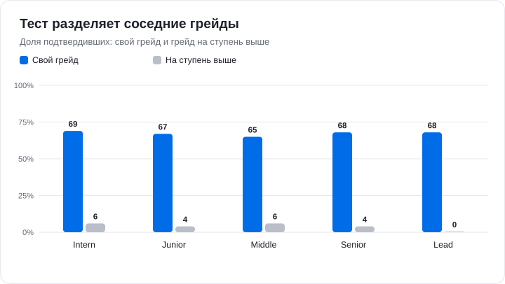
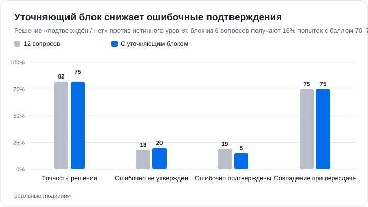
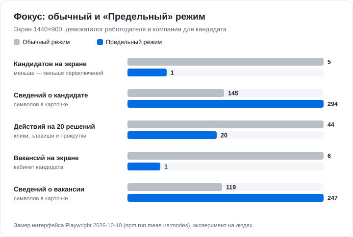

# predel

Платформа подбора ИТ-специалистов. Грейд кандидата подтверждается тестом, а работодатель ищет людей по задачам команды, а не по ключевым словам.

Сайт: **[predel-ai.ru](https://predel-ai.ru)**

**Кандидат** заполняет анкету (можно из резюме), проходит тест на свой грейд и получает подтверждённую категорию. Видит процент готовности профиля, компании и вакансии — списком или в «Предельном режиме», откликается и выполняет короткие задания от компаний.

**Работодатель** описывает потребности команды — подбор запускается сразу. Смысловой поиск на дообученном RuBERT-tiny2 показывает процент совпадения с разбивкой по сигналам. Дальше — приглашения, вакансии, отклики и регулярные задания с ИИ-разбором ответа.

**ИИ** — только открытые модели через OpenRouter: Qwen отвечает в помощниках (отдельный для каждой роли) и генерирует задания, DeepSeek независимо их проверяет. **ФСП** — вход через ФСП ID (OIDC + PKCE) и достижения участника в профиле.

## Тест

- 12 зачётных вопросов: 3 темы × 2 уровня сложности × 2 задания, плюс до одного незачётного пилотного. Порог — 70 баллов.
- Вопросы приходят по одному, на каждый 2 минуты, вернуться нельзя. Тест идёт в полноэкранном режиме; уход со вкладки — нарушение, третье аннулирует попытку на сервере.
- Если порог пройден впритык (9 из 12), добавляется уточняющий блок из 6 вопросов: ошибочных подтверждений грейда в модели становится меньше — с 19% до 14–15% (от прогона к прогону).
- Прошедший закрытую часть решает 2 открытые задачи своего грейда — текст, код или SQL. Их проверяет модератор по рубрике, итог — 50% закрытой и 50% открытой части ([открытые задачи](docs/open_tasks.md)).
- Банк динамический: задание из генератора сначала показывается как пилотное и попадает в зачёт после калибровки по ответам или одобрения модератора. Генератор переносит замысел задачи, а не меняет числа; копии «с другими числами» отклоняются.
- Провал закрывает грейд на 7 дней, грейды ниже доступны сразу; от 90 баллов сразу открывается следующий грейд.





Оба графика — симуляция на синтетических кандидатах (модель IRT 3PL поверх настоящей сборки попыток), а не данные людей; реальные параметры заданий даёт пилот. [Отчёт](docs/assessment_validation_results.md).

## «Предельный режим»

В «Предельном режиме» на экране одна карточка с полными сведениями. Решение — свайп или клавиша, а не «открыть профиль → закрыть → прокрутить».



Это замер интерфейса (Playwright, `npm run measure:modes`), а не A/B-тест: эксперимент на людях ещё не проводился. Для пилота предлагаются метрики: доля решений за сессию, приглашения на 100 просмотренных карточек и время до первого приглашения.

## Запуск

**Docker** — интерфейс и API на http://localhost:8787, тестовые аккаунты создаются автоматически:

```bash
docker compose up --build app
```

**Стенд predel-ai.ru** — тот же образ за Caddy с HTTPS: `docker compose --profile deploy up -d --build` ([инструкция](docs/deploy.md)).

**Локально** — Node.js 24 и Python 3.11–3.12 для модели поиска:

```bash
npm ci && npm ci --prefix frontend
npm run setup:local-accounts
npm run dev
```

Откройте http://127.0.0.1:5173. Веса обученной модели поиска в Git не хранятся. Без них работают фильтры, а текстовый запрос отвечает «поиск по смыслу недоступен». Обучение и активация модели описаны в [semantic_model.md](docs/semantic_model.md). Ключ OpenRouter задаётся в `.env` (`OPENROUTER_API_KEY`). Без ключа помощники отвечают готовыми подсказками, тест работает на авторском банке, а разбор заданий проверяет полноту по ключевым словам.

| Кабинет | Логин | Пароль |
| --- | --- | --- |
| Работодатель | `local_employer` | `LocalDemo2026!` |
| Кандидат | `local_candidate` | `LocalDemo2026!` |
| Модератор | `local_moderator` | `LocalDemo2026!` |

Аккаунты видны и на странице входа. Работодатель видит 147 демопрофилей, две потребности и задания на всех этапах. Кандидат видит 16 демокомпаний и профиль с подтверждённой категорией. Модератор сразу открывает проверку тестов: там ждёт попытка тестового кандидата с открытыми ответами, видны ключи, рубрики и происхождение вопросов. Тестовые аккаунты изолированы от реальных пользователей. Вход через ФСП ID работает на демонстрационном realm с вымышленными участниками.

## API и проверки

- Swagger UI: `/api/docs`, документ — [docs/api/platform.openapi.json](docs/api/platform.openapi.json). Тест сверяет его с маршрутами сервера.
- `npm run test:server` — серверные тесты; `npm run test:browser:all` — все браузерные сценарии подряд, каждый на своём временном сервисе (выборочно: `npm run test:browser:all -- tasks resume`).
- `npm run test:resume-unit` — парсер, каталоги, перенос ручных правок, история и PDF; `npm run test:resume-form` — сквозной браузерный сценарий анкеты (требуется Playwright Chromium).
- `npm run validate:assessment-model` и `npm run measure:modes`, затем `npm run charts` — пересобрать графики.

## Документация

[Анкета и зависимости по ТЗ](docs/resume_tz_audit.md) · [проверки импорта и их ограничения](docs/resume_validation.md).

[Навигация](docs/README.md) · [архитектура](docs/architecture.md) · [статус по ТЗ](docs/case_status.md) · [динамический банк](docs/dynamic_bank.md) · [прокторинг](docs/assessment_integrity.md) · [правила попыток](docs/assessment_policy.md) · [открытые задачи](docs/open_tasks.md) · [процент совпадения](docs/search_match.md) · [задания](docs/employer_tasks.md) · [LLM](docs/llm_usage.md) · [ФСП ID](docs/fsp_id.md) · [защита от мошенничества](docs/employer_protection.md) · [подробности реализации](docs/details.md)
