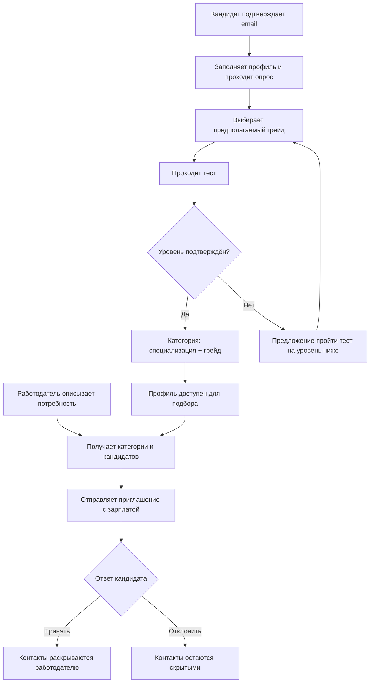

# Документация продукта

Платформа подбора ИТ-специалистов с обязательным подтверждением категории через опрос и тестирование. Работодатель описывает потребность, находит кандидатов и направляет персональное приглашение с зарплатной вилкой. Публикация вакансии для приглашения не требуется.

## Документы

| Файл | Назначение |
| --- | --- |
| [problem_definition.md](problem_definition.md) | Первоначальное краткое описание задачи; сохранено без изменения содержимого |
| [ФСП спец. трек ТЗ.pdf](specifications/ФСП%20спец.%20трек%20ТЗ.pdf) | Полное техническое задание 2026 года |
| [product_brief.md](product_brief.md) | Назначение продукта, пользователи, ожидаемая ценность, гипотезы и бизнесовая рамка |
| [mvp_scope.md](mvp_scope.md) | Обязательный объём, дополнительные функции, порядок работ и условия готовности |
| [use_cases.md](use_cases.md) | Пользовательские сценарии, условия, результаты, исключения и проверки готовности |
| [user_stories.md](user_stories.md) | 20 историй с критериями приёмки и связями с use cases и требованиями MVP |
| [business_rules.md](business_rules.md) | Категоризация, тестирование, ранжирование, статусы, видимость данных и роль ML |
| [metrics_and_validation.md](metrics_and_validation.md) | Процедуры оценки, определения метрик и форма отчёта без вымышленных результатов |
| [resume_requirements.md](resume_requirements.md) | Требования ТЗ к импорту резюме, дополнительные поля анкеты и фактическая обработка данных |
| [resume_validation.md](resume_validation.md) | Результаты проверки импорта четырёх резюме, OCR и сценариев приватности |
| [directions_validation.md](directions_validation.md) | Справочник 14 специализаций, 25 отраслей и результаты проверки полного пути ML-кандидата |
| [assessment_validation.md](assessment_validation.md) | Проверки структуры 70 программ, формирования из вакансий и скрытых ответов |
| [semantic_model.md](semantic_model.md) | Открытая модель, реальное дообучение, разделение train/dev/test, измерения и ограничения |
| [interface.md](interface.md) | Реализованные сценарии интерфейсного прототипа, запуск и границы демонстрации |

## Как читать

При расхождении краткого описания и полного ТЗ продуктовая логика в этих документах опирается на полное ТЗ. Например, API ФСП не предоставляется, а приглашение не требует опубликованной вакансии.

В документации используются три пометки:

- **Обязательно по ТЗ** — требование к основной реализации MVP.
- **Дополнительно по ТЗ** — желательная функция, которую можно отложить.
- **Предложение команды** — выбранная для проектирования логика, которую ТЗ не фиксирует буквально. Она описывает план, а не уже реализованную функциональность.

Рекомендуемый порядок чтения: описание продукта → границы MVP → user stories и use cases → бизнес-правила → план валидации. Критерии приёмки описывают, что нужно проверить; фактическое поведение и ограничения находятся в [описании интерфейса](interface.md), а результаты — в отчётах проверок и обучения.

## Основной путь

Достижения ФСП усиливают подтверждённый профиль, но не заменяют обязательное тестирование. Отсутствие истории ФСП не блокирует участие.

## Объём MVP

В основной объём входят два кабинета, подтверждение email, профиль кандидата и генерация PDF, опрос и тест, категория и история результатов, связь с FSP ID, настройки видимости, профиль компании, описание потребности, поиск и объяснимая подборка, приглашения и их статусы.

Публикация вакансий, самостоятельные отклики и регулярные короткие задания — дополнительный объём. Верификация работодателей и интеграция с ATS требуют концепции дальнейшего развития, но не рабочей реализации в MVP. Keycloak, Docker и мобильная адаптация не являются обязательными условиями MVP.

Формирование собственных данных и проверка качества тестирования и подбора входят в подготовку решения к сдаче. На механику подбора приходится 35% оценки, на тестирование, валидацию и категоризацию — 25%.

## Соответствие полному ТЗ

| Раздел ТЗ | Где описана пользовательская логика |
| --- | --- |
| 2: обязательный путь, категоризация, тестирование и ФСП | UC-C02–UC-C06; разделы 2–4 business_rules.md |
| 2.1: кабинет кандидата | UC-C01–UC-C10 |
| 2.1: кабинет работодателя | UC-E01–UC-E08 |
| 2.1: поиск, ранжирование и сохранение подборки | UC-E03–UC-E05; раздел 5 business_rules.md |
| 2.2: зарплата, контакты, статусы и регистрация | UC-A01, UC-C07–UC-C08, UC-E06–UC-E07; разделы 1 и 6–7 business_rules.md |
| 3.4 и 6: валидация и обоснование механик | Разделы 3, 8–9 business_rules.md |

Матрица обязательных требований R-01–R-18 и результатов сдачи D-01–D-06 находится в [mvp_scope.md](mvp_scope.md). Подробный протокол оценки и незаполненный отчёт — в [metrics_and_validation.md](metrics_and_validation.md).

## Что потребуется при сдаче

- Репозиторий с читаемым исходным кодом.
- Презентация в PPTX или PDF.
- Развёрнутый прототип; если это невозможно — демонстрационное видео и точная инструкция локального запуска.
- Сопроводительная документация в DOC или PDF: архитектура, механики и их обоснование, результаты валидации, схема интеграции с ФСП, API, версии компонентов и инструкция запуска.
- Документированное API через OpenAPI с запросами, ответами и кодами ошибок.

Текущие Markdown-файлы — исходная продуктовая документация. Серверное хранение, права между анонимными сессиями и локальный семантический поиск уже реализованы; границы указаны в [interface.md](interface.md) и [серверном контракте](../server/README.md). Настоящая регистрация с подтверждением email, независимая валидация и финальный пакет сдачи ещё требуют подготовки.
