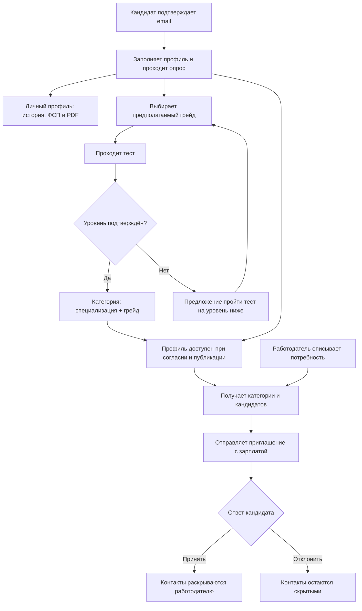

# Документация продукта

Платформа подбора ИТ-специалистов с обязательным подтверждением категории через опрос и тестирование. Работодатель описывает потребность, находит кандидатов и направляет персональное приглашение с зарплатной вилкой. Публикация вакансии для приглашения не требуется.

## Документы

| Файл | Назначение |
| --- | --- |
| [LICENSE](../LICENSE) | Лицензия MIT на исходный код и собственную документацию проекта |
| [problem_definition.md](problem_definition.md) | Первоначальное краткое описание задачи; сохранено без изменения содержимого |
| [ФСП спец. трек ТЗ.pdf](specifications/ФСП%20спец.%20трек%20ТЗ.pdf) | Полное техническое задание 2026 года |
| [Ответы на вопросы](specifications/Ответы%20на%20вопросы%20трек%20ФСП%20ЛЦТ__.xlsx) | Уточнения организаторов, предоставленные командой; дополняют требования кейса |
| [Саммари Q&A](specifications/qa-summary-fsp-2026.md) | Переданный командой пересказ встречи; дополнительный контекст, письменные уточнения имеют приоритет при расхождении |
| [product_brief.md](product_brief.md) | Назначение продукта, пользователи, ожидаемая ценность, гипотезы и бизнесовая рамка |
| [product_convenience.md](product_convenience.md) | Удобство интерфейса для проверяющих: вход, сценарии обеих ролей, критерии и материалы проверки |
| [mvp_scope.md](mvp_scope.md) | Обязательный объём, дополнительные функции, порядок работ и условия готовности |
| [use_cases.md](use_cases.md) | Пользовательские сценарии, условия, результаты, исключения и проверки готовности |
| [user_stories.md](user_stories.md) | 20 историй с критериями приёмки и связями с use cases и требованиями MVP |
| [business_rules.md](business_rules.md) | Категоризация, тестирование, ранжирование, статусы, видимость данных и роль ML |
| [metrics_and_validation.md](metrics_and_validation.md) | Процедуры проверки, результаты подбора на 50 размеченных потребностях, сравнение с базовой линией, абляции и границы выводов |
| [resume_requirements.md](resume_requirements.md) | Требования ТЗ к импорту резюме, дополнительные поля анкеты и фактическая обработка данных |
| [resume_validation.md](resume_validation.md) | Актуальные проверки структурированной анкеты, импорта, истории и PDF; прежние OCR-прогоны и пределы подтверждения |
| [resume_tz_audit.md](resume_tz_audit.md) | Аудит зависимостей анкеты и личного кабинета, соответствие ТЗ и приоритеты дальнейших проверок |
| [directions_validation.md](directions_validation.md) | Справочник 14 специализаций, 25 отраслей и результаты проверки полного пути ML-кандидата |
| [assessment_validation.md](assessment_validation.md) | Процедура валидации тестирования и проверки структуры 70 программ, формирования из вакансий и скрытых ответов |
| [assessment_validation_results.md](assessment_validation_results.md) | Симуляция на синтетических кандидатах: разделяющая сила, повторное прохождение, точность решения, устойчивость к утечке |
| [assessment_design.md](assessment_design.md) | Проект отдельного адаптивного пути: компетенции, рубрики, персонализация и план валидации; действующий экзамен с открытыми задачами описан в open_tasks.md |
| [open_assessment_bank.md](open_assessment_bank.md) | Экспериментальный авторский банк открытых задач: источники, рубрики, условия грейдов и закрытый экспорт; этот банк к рабочему экзамену не подключён |
| [review-bank/README.md](review-bank/README.md) | Банк кейсов действующего экзамена: 165 открытых задач и 165 закрытых кейсов с 330 вопросами, 33 компетенции, 69 источников; эмпирическая сложность требует проверки |
| [openrouter_assessment.md](openrouter_assessment.md) | Открытые Qwen и DeepSeek через OpenRouter: проверка черновиков, предварительный контекст, рекомендации организаторов и границы проверки |
| [assessment_integrity.md](assessment_integrity.md) | Прокторинг: последовательная выдача, лимит времени на вопрос, полноэкранный режим, аннулирование после трёх уходов, блокировка буфера и журнал |
| [fsp_id.md](fsp_id.md) | Вход через ФСП ID: OpenID Connect + PKCE, тестовый стенд Keycloak, импорт достижений, подключение боевого Keycloak |
| [search_match.md](search_match.md) | Процент совпадения в подборке: сигналы, базовые веса, их обоснование по ТЗ и пересчёт под запрос |
| [open_tasks.md](open_tasks.md) | Открытые задачи действующего экзамена, генерация вариантов, независимая оценка двумя моделями и перепроверка экспертом |
| [employer_tasks.md](employer_tasks.md) | Регулярные задания от работодателя, ИИ-разбор ответа и отметка свежести профиля |
| [employer_protection.md](employer_protection.md) | Защита от фиктивных вакансий и недобросовестных работодателей: что работает и следующий этап |
| [api/platform.openapi.json](api/platform.openapi.json) | Полный OpenAPI основного API (Swagger UI — `/api/docs`) |
| [details.md](details.md) | Подробный прежний обзор: статус модулей, запуск модели поиска, ограничения и история проверок |
| [architecture.md](architecture.md) | Архитектура: компоненты, потоки данных, права ролей, развёртывание и масштабирование |
| [bank_quality.md](bank_quality.md) | Качество закрытого банка: угадывается ли ответ без знаний (по длине, словам вопроса, без условия), переработка очевидных неверных вариантов двумя судьями |
| [dynamic_bank.md](dynamic_bank.md) | Динамический банк: авторские семейства, генерация открытой Qwen, проверка DeepSeek, пилотные задания, калибровка и контроль экспозиции |
| [assessment_policy.md](assessment_policy.md) | Пересдача через 7 дней, грейды ниже без ожидания, смена категории раз в 90 дней независимо от балла; личный профиль доступен после анкеты |
| [llm_usage.md](llm_usage.md) | Открытые модели: ИИ-помощники кандидата и работодателя, генерация и проверка заданий; что передаётся и зачем |
| [ats_integration.md](ats_integration.md) | Концепция ATS: синхронизация вакансий, откликов и статусов, повторы, конфликты и ограничения передачи данных |
| [Предлагаемый ATS OpenAPI](contracts/ats.openapi.json) и [примеры](examples/ats/README.md) | Проект будущего контракта; описанные маршруты в сервере пока отсутствуют |
| [semantic_model.md](semantic_model.md) | Открытые модели, обучение, разделение train/dev/test, архитектура и локальный запуск |
| [employer_needs.md](employer_needs.md) | Сохраняемые потребности, рекомендации категорий, выбор кандидатов, контракт и проверки прав |
| [interface.md](interface.md) | Реализованные сценарии интерфейса, запуск, проверки и границы реализации |

## Как читать

[Интеграции и внешние доказательства](integrations.md): реализованные маршруты основного Node.js API, OIDC, синхронизация, права, [OpenAPI](api/integrations.openapi.json) и [предлагаемый контракт ресурса ФСП](api/fsp-provider.openapi.json).

При расхождении краткого описания и полного ТЗ продуктовая логика в этих документах опирается на полное ТЗ. Например, API ФСП не предоставляется, а приглашение не требует опубликованной вакансии.

В документации используются три пометки:

- **Обязательно по ТЗ** — требование к основной реализации MVP.
- **Дополнительно по ТЗ** — желательная функция, которую можно отложить.
- **Предложение команды** — проектное решение, которое ТЗ не фиксирует буквально. Его реализация и проверки описаны в профильном документе и [описании интерфейса](interface.md).

Рекомендуемый порядок чтения: описание продукта → границы MVP → user stories и use cases → бизнес-правила → план валидации. Критерии приёмки описывают, что нужно проверить; поведение и ограничения находятся в [описании интерфейса](interface.md), а устройство семантического подбора и запуск — в [техническом описании модели](semantic_model.md).

## Основной путь

Достижения ФСП усиливают подтверждённый профиль, но не заменяют обязательное тестирование. Отсутствие истории ФСП не блокирует участие.

## Объём MVP

В основной объём входят два кабинета, подтверждение email, профиль кандидата и генерация PDF, опрос и тест, категория и история результатов, связь с FSP ID, настройки видимости, профиль компании, описание потребности, поиск и объяснимая подборка, приглашения и их статусы.

Публикация вакансий, самостоятельные отклики и регулярные короткие задания — дополнительный объём. Верификация работодателей и интеграция с ATS требуют концепции дальнейшего развития, но не рабочей реализации в MVP. Keycloak, Docker и мобильная адаптация не являются обязательными условиями MVP.

Формирование собственных данных и проверка качества тестирования и подбора входят в подготовку решения к сдаче. На механику подбора приходится 35% оценки, на тестирование, валидацию и категоризацию — 25%.

## Соответствие полному ТЗ

| Раздел ТЗ | Где описана пользовательская логика |
| --- | --- |
| 2: обязательный путь, категоризация, тестирование и ФСП | UC-C02–UC-C06; разделы 2–4 business_rules.md |
| 2.1: кабинет кандидата | UC-C01–UC-C10 |
| 2.1: кабинет работодателя | UC-E01–UC-E08 |
| 2.1: поиск, ранжирование и сохранение подборки | UC-E03–UC-E05; раздел 5 business_rules.md |
| 2.2: зарплата, контакты, статусы и регистрация | UC-A01, UC-C07–UC-C08, UC-E06–UC-E07; разделы 1 и 6–7 business_rules.md |
| 3.4 и 6: валидация и обоснование механик | Разделы 3, 8–9 business_rules.md |

Матрица обязательных требований R-01–R-18 и результатов сдачи D-01–D-06 находится в [mvp_scope.md](mvp_scope.md). Процедуры проверки и план исследований — в [metrics_and_validation.md](metrics_and_validation.md).

## Материалы сдачи по ТЗ

- Репозиторий с читаемым исходным кодом.
- Презентация в PPTX или PDF.
- Развёрнутый прототип; если это невозможно — демонстрационное видео и точная инструкция локального запуска.
- Сопроводительная документация в DOC или PDF: архитектура, механики и их обоснование, результаты валидации, схема интеграции с ФСП, API, версии компонентов и инструкция запуска.
- Полное описание API с запросами, ответами и кодами ошибок; OpenAPI — рекомендуемый формат по §3.5 с учётом свободы стека в §3.2.

В репозитории представлены исходный код, продуктовая и техническая документация, [полный OpenAPI основного API](api/platform.openapi.json), [архитектура](architecture.md) и [инструкция развёртывания](deploy.md). Реализованы регистрация с проверкой email-кода, серверное хранение и права аккаунтов, согласия с версией и временем, атомарное удаление аккаунта и связанных данных, семантический поиск, приглашения, вакансии, отклики и регулярные задания. Действующий экзамен включает [открытые практические задачи с автоматической оценкой и перепроверкой экспертом](open_tasks.md).

Результаты проверки структуры программ, вариантов и скрытых ответов опубликованы в [assessment_validation.md](assessment_validation.md), моделирования разделения грейдов и стабильности пересдачи — в [assessment_validation_results.md](assessment_validation_results.md). Метрики релевантности на размеченном наборе из 50 потребностей, сравнение с базовой линией и абляции приведены в [metrics_and_validation.md](metrics_and_validation.md#14-релевантность-подбора-размеченный-набор-и-метрики). Каждый отчёт описывает свой набор данных и границы выводов.

Текущие пользовательские сценарии и ограничения описаны в [interface.md](interface.md), проверки импорта, истории и PDF — в [resume_validation.md](resume_validation.md), соответствие анкеты ТЗ — в [resume_tz_audit.md](resume_tz_audit.md). Реквизиты оператора внесены в политику конфиденциальности. Форматы сопроводительных материалов перечислены выше согласно ТЗ.

## Внешние подтверждения

- [Публичные источники ФСП и OCR-пилот](fsp-public-research.md) — результаты исследования, запуск импортёра и поиск по официальному протоколу.
- [Привязка достижений и модерация](achievement-moderation.md) — отдельные аккаунты модераторов, заявки, приватные материалы и проверка принадлежности результата.
- [Парсинг официальных таблиц и новостей](public-achievements.md) — реестр источников, очередь обновлений и поиск команды или участника.
- [Codeforces: привязка аккаунта и импорт результатов](codeforces-integration.md).
- [AtCoder, Kaggle и GitHub: привязка, импорт, контракты и настройка](external-achievements.md).

Публичная запись не доказывает принадлежность кандидату без отдельной проверки. Рабочая механика адаптера и проверки на подставных ответах не подтверждают успешную реальную авторизацию внешнего аккаунта.
