# Привязка достижений, модерация и проверка публичных источников

Реализовано в основном Node.js backend и React. Контракты добавлены в [integrations.openapi.json](api/integrations.openapi.json), версия 1.5.0. В дополнительный FastAPI модуль не перенесён.

## Сценарий кандидата

1. Сохранить профиль с согласием на обработку данных.
2. В профиле найти своё имя или команду в «Результатах из открытых источников» и выбрать «Это мой результат».
3. Описать участие, добавить до пяти HTTPS-ссылок и/или один PDF, PNG или JPEG до 2 МБ. Отдельно согласиться на проверку материалов.
4. Отправить заявку. Статус `pending` не создаёт подтверждения и не повышает признак ФСП в каталоге.
5. После запроса уточнений дополнить материалы и отправить заявку повторно. Можно сохранить прежнее вложение или заменить его.
6. После одобрения результат появляется в серверных доказательствах профиля с пометкой «Подтверждено модератором». Работодатель видит его только по существующим правилам доступа к опубликованному профилю с согласием и подтверждённой категорией.
7. Отозвать заявку — подтверждение и соответствующий признак ФСП снимаются сразу. Материалы и история остаются для повторной подачи. Отзыв согласия профиля либо удаление профиля удаляет заявки, вложения и историю целиком.

Грейд и результаты профессионального теста этот модуль не меняет. Алгоритмическое соревнование служит свидетельством по направлению «Алгоритмы/Структуры данных», а не доказательством конкретного языка, стека или грейда.

## Право модератора

Основные роли по-прежнему `candidate` и `employer`. Независимое право `canModerate` назначается только оператором сервера существующему подтверждённому аккаунту:

```sh
npm run moderator -- grant <login-or-email>
npm run moderator -- list
npm run moderator -- revoke <login-or-email>
```

Команда использует `ASSESSMENT_DB` из окружения/`.env`, по умолчанию `server/data/assessment.sqlite`. Для отдельного файла базы укажите абсолютный путь. Регистрация не принимает право модерации. Обычный пользователь, включая работодателя, не получает доступ к очереди. Назначения и отзывы записываются в `auth_moderator_audit`; право проверяется при каждом запросе, поэтому отзыв действует и на уже созданные сессии.

После назначения обновить страницу. В кабинете появится «Модерация»; прямой адрес — `/moderation`. Это отдельная страница, не требующая прохождения анкеты или профессионального теста модератором.

## Решения и защита от ошибок

Статусы: `pending`, `needs_info`, `approved`, `rejected`, `withdrawn`, `revoked`.

- Модератор открывает заявку, видит исходный протокол, материалы кандидата, автоматические проверки и историю действий.
- `request_information` возвращает заявку для уточнения; `reject` отклоняет с обоснованием.
- `approve` требует обоснования, явного `ownershipConfirmed=true`, способа проверки и отдельного основания установления принадлежности. Способы: `document_review`, `organizer_confirmation`, `account_ownership`.
- `revoke` снимает ранее одобренное подтверждение. Одобренную заявку можно повторно проверить и продлить.
- Свои заявки модерировать нельзя, даже при наличии права модератора.
- Одновременно один индивидуальный результат может иметь только одного одобренного владельца. Ограничение защищено уникальным индексом SQLite. Разные кандидаты могут подать заявки на один результат, но наличие чужой одобренной привязки блокирует следующее одобрение.
- Для командной записи обязательно `teamMembershipConfirmed=true`: модератор проверяет участие кандидата в составе именно на этом соревновании. Один командный результат разрешено одобрить нескольким участникам. Личный вклад и грейд по командному месту не устанавливаются.
- Каждое изменение требует актуальную `version`. Устаревшее решение возвращает 409; оно не перезаписывает новые материалы или решение другого модератора.
- Изменённый, исчезнувший или недоступный источник блокирует одобрение. Во время сетевой проверки источника одобрение также блокируется.
- До 20 незавершённых заявок на владельца; до 10 созданий/переподач за 10 минут. Пагинация очереди: до 50 заявок на страницу.

Одобрение принадлежности действует 90 дней и может быть продлено модератором. Если изменилось имя профиля или запись/хеш протокола, подтверждение становится неактивным раньше. Новый проверенный каталог не обновляет уже одобренную заявку автоматически: нужно повторно отправить заявку с актуальным снимком. Признак ФСП пересчитывается при решениях, изменении профиля и проверке источника; минутный worker также учитывает истечение срока.

## Что проверяет парсинг

Две независимые проверки:

1. **Результат опубликован в источнике.** OCR извлекает строки официального PDF. Проверенный каталог сохраняет ФИО, место, результат, регион, страницу и SHA-256 исходного документа. Эти поля берутся на сервере из каталога: кандидат не может передать собственное место, баллы или статус источника.
2. **Результат принадлежит кандидату.** Нужны материалы и решение модератора либо в будущем доверенная связь с аккаунтом источника. Совпадение ФИО — подсказка для проверки. Распознанный текст диплома — содержание файла, а не доказательство его подлинности.

Действующий движок `fsp-claim-checks-v1` сравнивает снимок заявки с текущей записью каталога, ФИО профиля, наличие материалов и чужую одобренную привязку. Он возвращает `manual_review`, `request_information` или `blocked`; `ownershipAutomaticallyConfirmed` всегда `false`.

Кнопка «Проверить свежесть источника» выполняет серверный запрос к зарегистрированному официальному PDF и сравнивает хеш с проверенным каталогом. Разрешены только `https://fsp-russia.ru/upload/iblock/...pdf`, до 10 МБ, 10 секунд, без редиректов. Произвольные ссылки и файлы кандидатов сервер не скачивает. Проверки источников имеют отдельный лимит 5/10 минут на модератора.

Ответы: `matched`, `changed`, `missing`, `unavailable`. Изменение/недоступность протокола делает связанные подтверждения неактивными; успешная повторная проверка может восстановить актуальность, если хеш и запись совпадают. Для этого PDF сетевой вызов выполняется по кнопке. Для зарегистрированных HTML-таблиц и новостей включён отдельный ежедневный сборщик; см. [открытые публикации](public-achievements.md). Хеш показывает совпадение документа с проверенной версией, но не является электронной подписью Федерации.

## Как расширять систему парсинга

Работающий публичный импортёр описан в [исследовании ФСП](fsp-public-research.md). Сейчас поддержан один двухстраничный алгоритмический финал с 24 записями. Для других форматов нужен отдельный профиль/адаптер, особенно для таблиц с объединёнными ячейками, командными составами и переносами страниц.

Для HTML-таблиц и новостей этот слой уже реализован: [сбор из открытых публикаций](public-achievements.md). Следующие пункты по OCR новых PDF и приватных материалов остаются развитием:

```mermaid
flowchart LR
  A[Реестр официальных источников] --> B[Загрузка и хеш документа]
  B --> C[Адаптер таблицы / OCR]
  C --> D[Проверка структуры и очередь ошибок]
  D --> E[Проверенный каталог результатов]
  E --> F[Заявка кандидата]
  F --> G[Сверка данных и материалов]
  G --> H[Проверка принадлежности]
  H --> I[Опубликованное доказательство]
```



- Реестр адаптеров по источнику/типу протокола вместо универсальных предположений о структуре PDF. Каждая запись имеет стабильный внешний идентификатор, оригинал, страницу, хеш, версию парсера и статус проверки распознавания.
- Фоновые задачи извлечения, ручная очередь ошибок OCR и публикация атомарного проверенного снимка. Изменение документа требует новой проверки, а не тихого переписывания действующих доказательств.
- OCR приватных материалов как подсказка модератору: имя, соревнование, дата, место, номер сертификата и расхождения с официальной записью. Запускать локально в отдельном worker, ограничивая число страниц, размер изображения и время. Полный текст хранить приватно и не показывать работодателю.
- Проверка сертификата через официальный реестр/QR/API, если организатор публикует такой сервис. QR и ссылки из кандидатов нельзя автоматически загружать произвольным HTTP-клиентом: источник должен быть зарегистрирован и ограничен заранее.
- Автоматическое подтверждение принадлежности допустимо только при доверенном соответствии аккаунта кандидата записи источника. Без такого соответствия решение остаётся за модератором.

OCR вложений, универсальные парсеры всех документов и автоматическая проверка подлинности дипломов в текущий модуль не входят. Реализованы пилотный PDF, адаптеры официальных HTML-таблиц и новостей, очередь сбора, сверка снимков/хеша, приватные материалы, решения и публикация подтверждённого результата.

## Хранение и приватность

`achievement_claims` хранит снимок официальной записи, состояние, версию и сроки проверки. В production требуется постоянный `INTEGRATION_ENCRYPTION_KEY` (64 hex-символа); без него маршруты заявок/модерации возвращают 503, а прежние подтверждения не считаются активными. В development используется существующий локальный файл ключа с правами 0600. Описание, ссылки и файл кандидата зашифрованы AES-256-GCM тем же операторским ключом, что и подключения источников. Основание установления принадлежности и детали аудита также зашифрованы. Файл не возвращается в JSON заявки: только имя, MIME, размер и SHA-256.

Скачивание — отдельный авторизованный маршрут владельца или модератора. Ответ содержит `Content-Disposition: attachment`, `no-store`, `nosniff`, CSP sandbox. Проверяются размер, допустимый MIME и сигнатура содержимого. Это проверка формата загрузки, а не подлинности документа или антивирусная проверка. Скачивания записываются в аудит.

Работодатель получает только публичные поля доказательства: соревнование, дисциплину, дату, результат, индивидуальное/командное участие, статус, источник, срок проверки и `verificationMethod=manual_review`. Приватные вложения, объяснения, ссылки кандидата, основание решения и история действий в этот ответ не входят.

## Проверки

```sh
npm run test:server
npm run build
npm run test:moderation-browser
npm run test:integrations-browser
```

Проверки модерации изолированы в памяти и не назначают права реальным аккаунтам, не используют пользовательские файлы и не отправляют настоящие email. Сетевой источник подменён контролируемым тестовым PDF.
