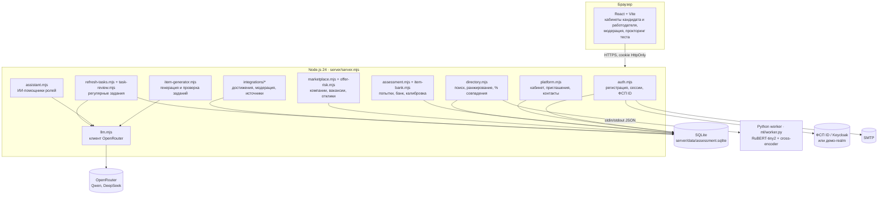

# Архитектура

Обновлено 10 октября 2026 года. Основной вариант — React-интерфейс, один процесс Node.js 24 с API и общей SQLite и постоянный Python-воркер смыслового поиска. Внешние сервисы необязательны: без OpenRouter, SMTP и ФСП ID платформа работает на встроенных сценариях.

## Компоненты

| Компонент | Ответственность | Хранилище |
| --- | --- | --- |
| `auth.mjs`, `fsp-id.mjs` | Регистрация с кодом, вход, сессии, роли (в том числе отдельный аккаунт модератора), вход через ФСП ID (OIDC + PKCE) | `auth_*` |
| `platform.mjs` | Состояние кабинета с ревизиями, анкеты (неизменяемые снимки), публикация профиля, приглашения, контакты по согласию | `platform_*`, `directory_candidates` |
| `assessment.mjs`, `store.mjs` | Сборка попытки, последовательная выдача, таймеры, прокторинг, оценка, уточняющий блок, правила пересдачи | `attempts`, `attempt_integrity_events` |
| `item-bank.mjs`, `item-generator.mjs` | Динамический банк: пилот, калибровка, вывод из оборота; генерация Qwen и проверка DeepSeek | `bank_items`, `item_stats`, `item_generation_log` |
| `directory.mjs`, `semantic-worker.mjs`, `search-*.mjs` | Смысловой допуск, переранжирование, подтверждённые выше, объяснения и процент совпадения | `directory_*`, векторы |
| `marketplace.mjs`, `offer-risk.mjs` | Компании, вакансии, отклики, проверка текста на мошеннические шаблоны | `marketplace_*` |
| `refresh-tasks.mjs`, `task-review.mjs` | Задания работодателя, повторы, свежесть профиля, ИИ-разбор ответа | `refresh_task_*` |
| `assistant.mjs` | Помощник кандидата и помощник работодателя: факты платформы, навигация, запрет подсказок к тесту | — |
| `integrations/*` | Внешние подтверждения (Codeforces, AtCoder, Kaggle, GitHub, ФСП-демо), публичные протоколы, модерация заявок | `integration_*`, `achievement_*` |
| `openapi.mjs` | Описание API, Swagger UI `/api/docs` | — |

## Основные потоки

**Подтверждение грейда.** Анкета → `POST /api/assessment/attempts`: сервер собирает 12 заданий (без ключей в ответе) и выдаёт первый вопрос → `/answer` по одному с серверным временем → `/integrity` получает уходы со страницы (третий аннулирует попытку) → `/submit` считает балл → `platform.save` принимает категорию только из серверного результата.

**Подбор.** Потребность работодателя → `GET /api/directory/search`: фильтры и права → энкодер в воркере → допуск по порогу → cross-encoder → подтверждённые тестом выше → объяснение и процент совпадения → страница результатов. Контакты — отдельный запрос, только после принятого приглашения или отклика.

**Динамический банк.** Попытка исчерпывает свежие задания семейства → очередь генерации → Qwen по образцам семейства и открытому банку → локальные проверки → DeepSeek решает без ключа → пилот (незачётный 13-й вопрос) → калибровка по ответам или одобрение модератора → зачёт.

## Права и данные

| Роль | Может | Не может |
| --- | --- | --- |
| Гость | Регистрация, вход, `/api/health`, OpenAPI | Любые данные кабинетов и каталога (`401`) |
| Соискатель | Свой кабинет, тест, компании и вакансии, отклики, ответы на задания, помощник | Каталог других людей, чужие контакты, ключи ответов |
| Работодатель | Каталог опубликованных профилей и демокаталог, потребности, приглашения, вакансии, задания, помощник | Контакты без согласия кандидата, тест, задания без отклика или приглашения |
| Модератор | Отдельный кабинет: проверка тестов и открытых задач, банк заданий, заявки на достижения, источники | Каталог, вакансии, приглашения, задания, тест и помощник (`403`); аккаунт создаёт только оператор сервера |

- Сессия — случайный токен в HttpOnly-cookie `SameSite=Strict`; в базе хранятся только хеши токенов, паролей и кодов.
- Запись в кабинет требует `X-Platform-Identity` и `baseRevision`: устаревшая вкладка получает `409`, а не перезаписывает данные.
- Удаление аккаунта — одна транзакция по всем таблицам.
- В LLM не уходят имена, контакты и идентификаторы. Используются только открытые модели с `data_collection: deny`.

## Развёртывание и масштабирование

- **Сейчас:** один контейнер ([Dockerfile](../Dockerfile), `docker compose up --build app`), SQLite в томе, веса модели подключаются только для чтения. SQLite в режиме WAL держит одновременные чтения. Запись короткая и транзакционная.
- **Дальше:** SQLite → PostgreSQL (схема уже разделена по модулям; [FastAPI-вариант](fastapi_migration.md) показывает перенос на SQLAlchemy). Поисковый воркер выносится в отдельный сервис с пулом процессов. Векторы кандидатов — в pgvector. Сессии и лимиты запросов — в Redis при нескольких экземплярах API.
- **Альтернативный FastAPI** живёт в `backend/` с отдельной базой и не заменяет основной сервер.
