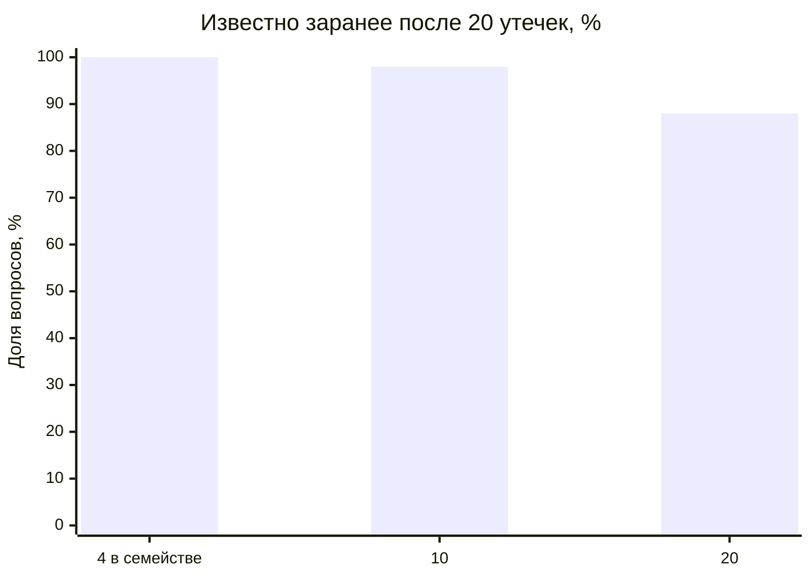

# Результаты валидации механики тестирования

Сгенерировано `npm run validate:assessment-model` (400 синтетических кандидатов на ячейку; ответы моделируются с фиксированным seed, а задания выбирает криптографический генератор платформы, поэтому повторные прогоны отличаются на 1–3 п. п.). Используются настоящие сборка попытки, выбор и исключение заданий, уточняющий блок, подсчёт балла и порог 70/100. Ответы задаёт модель IRT (3PL), параметры — в комментарии [скрипта](../scripts/validate-assessment.mjs). Это проверка механики при условии, что задания ведут себя как размечены авторами, а не калибровка на людях; организаторы прямо допускают симуляцию (PR.1). Процедура описана в [assessment_validation.md](assessment_validation.md).

## Разделяющая сила

Доля подтвердивших грейд. Строка — реальный уровень кандидата, столбец — грейд теста.

| Реальный \ Тест | Intern | Junior | Middle | Senior | Lead |
| --- | --- | --- | --- | --- | --- |
| Intern | 84% | 10% | 0% | 0% | 0% |
| Junior | 100% | 78% | 11% | 1% | 0% |
| Middle | 100% | 100% | 79% | 9% | 0% |
| Senior | 100% | 100% | 100% | 83% | 10% |
| Lead | 100% | 100% | 100% | 100% | 77% |

```mermaid
xychart-beta
  title "Подтверждают грейд: свой и на ступень выше, %"
  x-axis ["Intern", "Junior", "Middle", "Senior", "Lead"]
  y-axis "Доля, %" 0 --> 100
  bar [84, 78, 79, 83, 77]
  bar [10, 11, 9, 10, 0]
```

Свой грейд подтверждают в среднем 80%, грейд на ступень выше — 10%. Средняя точечно-бисериальная корреляция семейств заданий 0.32, у 80% семейств она не ниже 0,2.

## Повторное прохождение (test-retest)

Тот же кандидат сдаёт тот же грейд второй раз на новой форме (задания первой попытки исключены). Смесь заявок: 60% — свой грейд, 25% — на ступень выше, 15% — ниже.

| Показатель | 12 вопросов | С уточняющим блоком |
| --- | --- | --- |
| Совпадение решения «подтверждён / нет» | 75% | 77% |
| Каппа Коэна | 0.48 | 0.50 |
| Корреляция баллов двух форм | 0.67 | 0.69 |
| Точность решения относительно истинного уровня | 83% | 85% |
| Ложно подтверждённые (уровень ниже порога) | 16% | 24% |
| Ложно не подтверждённые | 18% | 11% |
| Попыток с уточняющим блоком | — | 22% |
| Вопросов в среднем | 12.0 | 13.3 |
| Общих заданий у двух форм | 0.00 | 1.32 |

```mermaid
xychart-beta
  title "Стабильность решения при пересдаче, %"
  x-axis ["Совпадение", "Точность", "Каппа × 100"]
  y-axis "%" 0 --> 100
  bar [75, 83, 48]
  bar [77, 85, 50]
```

Первый ряд — 12 вопросов, второй — с уточняющим блоком (6 вопросов при балле 55–74).

## Устойчивость к утечке заданий

Доля вопросов новой попытки, известных заранее, если в сеть утекли N попыток той же программы.

| Заданий в семействе | 1 утечка | 5 утечек | 20 утечек | 50 утечек |
| --- | --- | --- | --- | --- |
| 4 (авторский банк) | 51% | 96% | 100% | 100% |
| 10 (с генерацией) | 20% | 67% | 98% | 100% |
| 20 (с генерацией) | 11% | 43% | 88% | 99% |

Слабый кандидат (уровень Junior) сдаёт Middle, зная ответы из 20 утёкших попыток:

| Заданий в семействе | Подтверждают Middle |
| --- | --- |
| 4 | 100% |
| 10 | 100% |
| 20 | 100% |

Без утечки такой кандидат подтверждает Middle в 11% случаев. Конечный авторский банк расходится быстро, поэтому зачётный пул пополняется проверенными сгенерированными заданиями, сгенерированные выводятся после 150 показов, а последовательная выдача с лимитом 2 минуты на вопрос мешает собирать ответы во время теста.

## Выводы и ограничения

- Тест разделяет соседние грейды: свой грейд подтверждают 80%, грейд выше — 10%.
- Уточняющий блок (его получают 22% попыток) повышает точность решения с 83% до 85% и снижает долю ошибочно не подтверждённых с 18% до 11%; цена — ошибочно подтверждённых 16% → 24%. Совпадение решений при пересдаче: 75% → 77%.
- Формы практически не пересекаются: задания прошлой попытки исключаются.
- Параметры заданий заданы моделью. Настоящие сложность и дискриминацию даёт пилот: незачётные задания и статистика ответов в банке.
