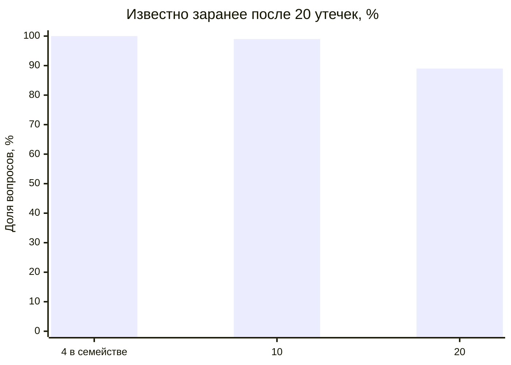

# Результаты валидации механики тестирования

Сгенерировано `npm run validate:assessment-model` (200 синтетических кандидатов на ячейку, фиксированный seed). Используются настоящие сборка попытки, выбор и исключение заданий, уточняющий блок, подсчёт балла и порог 70/100. Ответы задаёт модель IRT (3PL), параметры — в комментарии [скрипта](../scripts/validate-assessment.mjs). Это проверка механики при условии, что задания ведут себя как размечены авторами, а не калибровка на людях; организаторы прямо допускают симуляцию (PR.1). Процедура описана в [assessment_validation.md](assessment_validation.md).

## Разделяющая сила

Доля подтвердивших грейд. Строка — реальный уровень кандидата, столбец — грейд теста.

| Реальный \ Тест | Intern | Junior | Middle | Senior | Lead |
| --- | --- | --- | --- | --- | --- |
| Intern | 81% | 12% | 0% | 0% | 0% |
| Junior | 100% | 75% | 10% | 0% | 0% |
| Middle | 100% | 100% | 80% | 13% | 0% |
| Senior | 100% | 100% | 100% | 79% | 11% |
| Lead | 100% | 100% | 100% | 100% | 78% |

```mermaid
xychart-beta
  title "Подтверждают грейд: свой и на ступень выше, %"
  x-axis ["Intern", "Junior", "Middle", "Senior", "Lead"]
  y-axis "Доля, %" 0 --> 100
  bar [81, 75, 80, 79, 78]
  bar [12, 10, 13, 11, 0]
```

Свой грейд подтверждают в среднем 78%, грейд на ступень выше — 11%. Средняя точечно-бисериальная корреляция семейств заданий 0.31, у 73% семейств она не ниже 0,2.

## Повторное прохождение (test-retest)

Тот же кандидат сдаёт тот же грейд второй раз на новой форме (задания первой попытки исключены). Смесь заявок: 60% — свой грейд, 25% — на ступень выше, 15% — ниже.

| Показатель | 12 вопросов | С уточняющим блоком |
| --- | --- | --- |
| Совпадение решения «подтверждён / нет» | 74% | 77% |
| Каппа Коэна | 0.46 | 0.51 |
| Корреляция баллов двух форм | 0.66 | 0.70 |
| Точность решения относительно истинного уровня | 83% | 86% |
| Ложно подтверждённые (уровень ниже порога) | 14% | 25% |
| Ложно не подтверждённые | 19% | 9% |
| Попыток с уточняющим блоком | — | 21% |
| Вопросов в среднем | 12.0 | 13.2 |
| Общих заданий у двух форм | 0.00 | 1.24 |

```mermaid
xychart-beta
  title "Стабильность решения при пересдаче, %"
  x-axis ["Совпадение", "Точность", "Каппа × 100"]
  y-axis "%" 0 --> 100
  bar [74, 83, 46]
  bar [77, 86, 51]
```

Первый ряд — 12 вопросов, второй — с уточняющим блоком (6 вопросов при балле 55–74).

## Устойчивость к утечке заданий

Доля вопросов новой попытки, известных заранее, если в сеть утекли N попыток той же программы.

| Заданий в семействе | 1 утечка | 5 утечек | 20 утечек | 50 утечек |
| --- | --- | --- | --- | --- |
| 4 (авторский банк) | 49% | 98% | 100% | 100% |
| 10 (с генерацией) | 22% | 67% | 99% | 100% |
| 20 (с генерацией) | 8% | 40% | 89% | 100% |

Слабый кандидат (уровень Junior) сдаёт Middle, зная ответы из 20 утёкших попыток:

| Заданий в семействе | Подтверждают Middle |
| --- | --- |
| 4 | 100% |
| 10 | 100% |
| 20 | 100% |

Без утечки такой кандидат подтверждает Middle в 10% случаев. Конечный авторский банк расходится быстро, поэтому зачётный пул пополняется проверенными сгенерированными заданиями, сгенерированные выводятся после 150 показов, а последовательная выдача с лимитом 2 минуты на вопрос мешает собирать ответы во время теста.

## Выводы и ограничения

- Тест разделяет соседние грейды: свой грейд подтверждают 78%, грейд выше — 11%.
- Уточняющий блок повышает совпадение решений при пересдаче с 74% до 77% и точность с 83% до 86%; его получают 21% попыток.
- Формы практически не пересекаются: задания прошлой попытки исключаются.
- Параметры заданий заданы моделью. Настоящие сложность и дискриминацию даёт пилот: незачётные задания и статистика ответов в банке.
