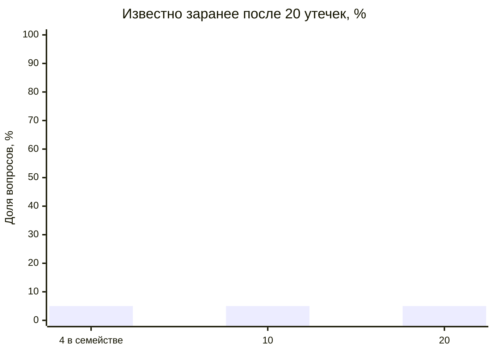

# Результаты валидации механики тестирования

Сгенерировано `npm run validate:assessment-model` (1500 синтетических кандидатов на ячейку; ответы моделируются с фиксированным seed, а задания выбирает криптографический генератор платформы, поэтому повторные прогоны отличаются на 1–3 п. п.). Используются настоящие сборка попытки, выбор и исключение заданий, уточняющий блок, подсчёт балла и порог 70/100. Ответы задаёт модель IRT (3PL), параметры — в комментарии [скрипта](../scripts/validate-assessment.mjs). Это проверка механики при условии, что задания ведут себя как размечены авторами, а не калибровка на людях; организаторы прямо допускают симуляцию (PR.1). Процедура описана в [assessment_validation.md](assessment_validation.md).

## Разделяющая сила

Доля подтвердивших грейд. Строка — реальный уровень кандидата, столбец — грейд теста.

| Реальный \ Тест | Intern | Junior | Middle | Senior | Lead |
| --- | --- | --- | --- | --- | --- |
| Intern | 69% | 6% | 0% | 0% | 0% |
| Junior | 99% | 67% | 4% | 0% | 0% |
| Middle | 100% | 99% | 65% | 6% | 0% |
| Senior | 100% | 100% | 99% | 68% | 4% |
| Lead | 100% | 100% | 100% | 100% | 68% |

```mermaid
xychart-beta
  title "Подтверждают грейд: свой и на ступень выше, %"
  x-axis ["Intern", "Junior", "Middle", "Senior", "Lead"]
  y-axis "Доля, %" 0 --> 100
  bar [69, 67, 65, 68, 68]
  bar [6, 4, 6, 4, 0]
```

Свой грейд подтверждают в среднем 67%, грейд на ступень выше — 5%. Средняя точечно-бисериальная корреляция семейств заданий 0.34, у 92% семейств она не ниже 0,2.

## Повторное прохождение (test-retest)

Тот же кандидат сдаёт тот же грейд второй раз на новой форме (задания первой попытки исключены). Смесь заявок: 60% — свой грейд, 25% — на ступень выше, 15% — ниже.

Сравнение парное: обе колонки посчитаны на одних и тех же попытках — по первым 12 вопросам и с уточняющим блоком.

| Показатель | 12 вопросов | С уточняющим блоком |
| --- | --- | --- |
| Совпадение решения «подтверждён / нет» | 90% | 90% |
| Каппа Коэна | 0.62 | 0.64 |
| Корреляция баллов двух форм | 0.82 | 0.82 |
| Точность решения относительно истинного уровня | 97% | 97% |
| Ложно подтверждённые (уровень ниже порога) | 4% | 0% |
| Ложно не подтверждённые | 3% | 5% |
| Попыток с уточняющим блоком | — | 16% |
| Вопросов в среднем | 12.0 | 13.0 |
| Общих заданий у двух форм | 0.99 | 0.99 |

```mermaid
xychart-beta
  title "Стабильность решения при пересдаче, %"
  x-axis ["Совпадение", "Точность", "Каппа × 100"]
  y-axis "%" 0 --> 100
  bar [90, 97, 62]
  bar [90, 97, 64]
```

Первый ряд — 12 вопросов, второй — с уточняющим блоком (6 вопросов при балле 70–79).

## Устойчивость к утечке заданий

Доля вопросов новой попытки, известных заранее, если в сеть утекли N попыток той же программы.

| Заданий в семействе | 1 утечка | 5 утечек | 20 утечек | 50 утечек |
| --- | --- | --- | --- | --- |
| 4 (авторский банк) | 1% | 2% | 5% | 5% |
| 10 (с генерацией) | 1% | 2% | 5% | 5% |
| 20 (с генерацией) | 1% | 2% | 5% | 5% |

Слабый кандидат (уровень Junior) сдаёт Middle, зная ответы из 20 утёкших попыток:

| Заданий в семействе | Подтверждают Middle |
| --- | --- |
| 4 | 50% |
| 10 | 48% |
| 20 | 45% |

Без утечки такой кандидат подтверждает Middle в 4% случаев. Конечный авторский банк расходится быстро, поэтому зачётный пул пополняется проверенными сгенерированными заданиями, сгенерированные выводятся после 150 показов, а последовательная выдача с лимитом 2 минуты на вопрос мешает собирать ответы во время теста.

## Выводы и ограничения

- Тест разделяет соседние грейды: свой грейд подтверждают 67%, грейд выше — 5%.
- Уточняющий блок получают 16% попыток — те, кто прошёл порог впритык. На тех же попытках он меняет долю ошибочно подтверждённых с 4% до 0%, ошибочно не подтверждённых — с 3% до 5%; точность решения 97% → 97%, совпадение при пересдаче 90% → 90%. Ошибочное подтверждение вредит работодателю, а ошибочный отказ кандидат может пересдать через 7 дней, поэтому блок перепроверяет именно прошедших.
- Формы практически не пересекаются: задания прошлой попытки исключаются.
- Параметры заданий заданы моделью. Настоящие сложность и дискриминацию даёт пилот: незачётные задания и статистика ответов в банке.
