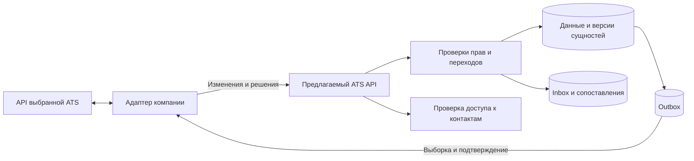
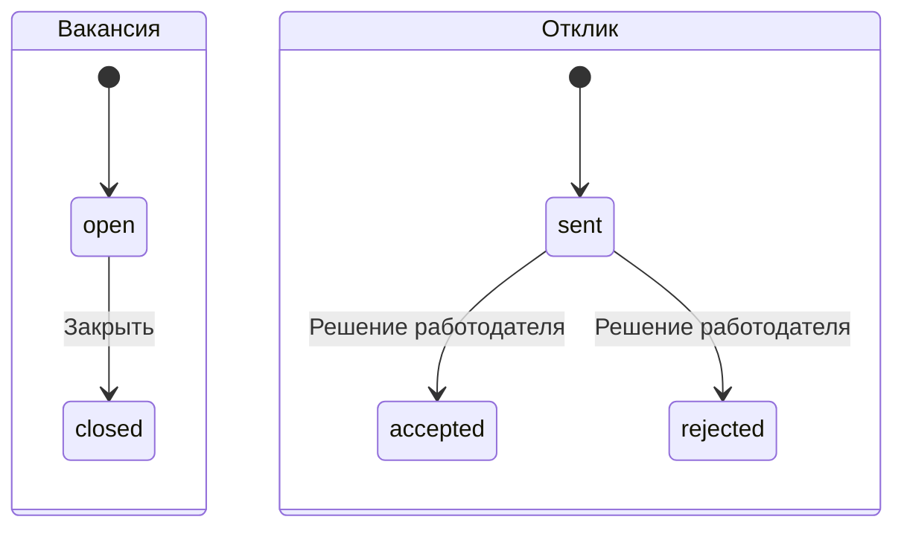
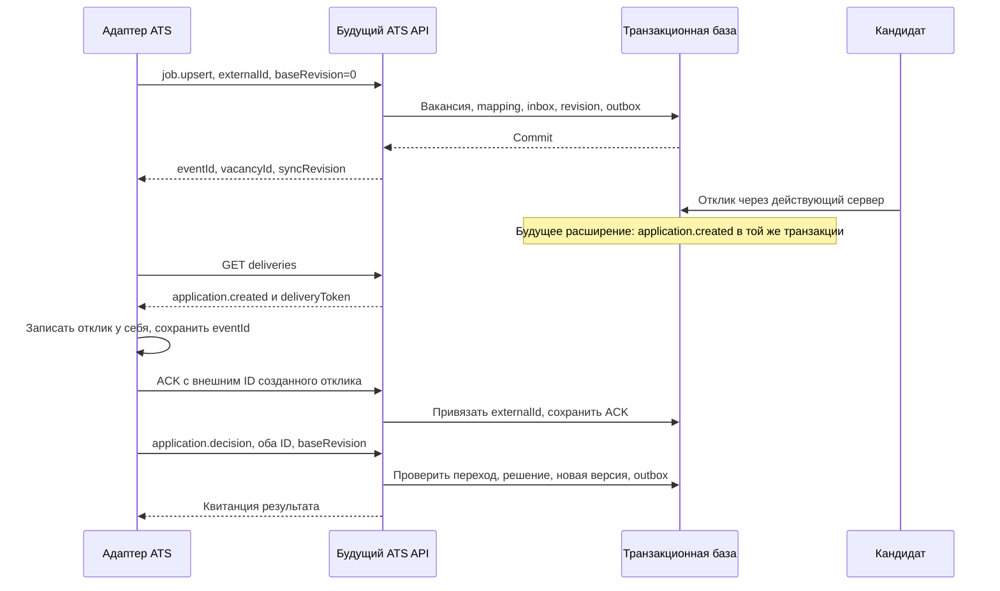

# Концепция интеграции с ATS

**Статус: проект интеграции, без работающего подключения.** Подготовлены правила синхронизации, предлагаемый [контракт OpenAPI](contracts/ats.openapi.json) и [примеры обмена](examples/ats/README.md). В основном сервере нет маршрутов `/api/ats/v1`, адаптера ATS, интеграционных токенов, журнала доставки и таблиц сопоставлений. Примеры содержат вымышленные данные и адрес стенда, который не существует.

Основание: дополнительная функция в [полном ТЗ](specifications/ФСП%20спец.%20трек%20ТЗ.pdf) и ответ **FTT.5** в [уточнениях организаторов](specifications/Ответы%20на%20вопросы%20трек%20ФСП%20ЛЦТ__.xlsx). Для MVP достаточно проработанной концепции синхронизации вакансий, откликов и статусов через API бизнеса. Работающее подключение к внешней ATS не требуется. Конкретный поставщик ATS пока не выбран; перечисленные далее правила — решение команды, а не дополнительные требования организаторов.

## 1. Граница обмена

ATS — внутренняя система работодателя для ведения вакансий и этапов найма. Платформа остаётся источником кандидатских действий, категории и результатов теста. Адаптер переводит API выбранного поставщика в единый контракт платформы; особенности конкретной ATS не попадают в клиентский интерфейс.

| Сущность | Направление | Кто меняет данные |
| --- | --- | --- |
| Связанная вакансия | ATS → платформа; платформа → ATS сообщает применённую версию | Подключённая компания через ATS; обязательные поля проверяет платформа |
| Отклик на вакансию | Платформа → ATS | Создаёт кандидат на платформе; ATS создаёт соответствующую запись у себя |
| Решение по отклику | ATS ↔ платформа | Работодатель: принять или отклонить существующий отклик |
| Приглашение и ответ | Платформа → ATS | Отправляет работодатель; просмотр, принятие и отказ выполняет кандидат |
| Этап найма в ATS | ATS, отдельно от статуса платформы | ATS; этап не подменяет ответ на отклик или приглашение |
| Контакты кандидата | Отдельный запрос ATS, после проверки доступа | Платформа проверяет владельца, отношение к кандидату и действующее разрешение на передачу |
| Согласие, подтверждённый грейд, анкета и тест | Не импортируются из ATS | Кандидат и серверные процедуры платформы |

ATS не создаёт аккаунты, фиктивные отклики или согласие от имени кандидата. Загруженное работодателем резюме не становится зарегистрированным и протестированным профилем. Непубликованная потребность компании и её подборка остаются внутренними данными; приглашение по-прежнему не требует вакансии. Отправка приглашений из ATS и импорт сторонних лидов не входят в первую версию концепции.

Основной Node.js backend — база для будущего подключения. Дополнительный FastAPI backend не является вторым источником тех же данных; одновременный обмен двух несинхронизированных баз запрещён. Реальные текущие маршруты перечислены в [server/README.md](../server/README.md).

## 2. Идентичность и предлагаемое хранение

Подключение создаёт вошедший владелец компании. Сервер связывает его с `companyId` и новым `connectionId`; тело события не может выбирать другого владельца. Интеграционный токен ограничен одним подключением и компанией. Для другой компании нужен отдельный токен и отдельные сопоставления.

| Поле | Назначение и правило |
| --- | --- |
| `connectionId` | Устойчивый идентификатор подключения к конкретной ATS; отключённый идентификатор не переиспользуется |
| `externalId` | Строковый ID сущности в ATS. Ведущие нули сохраняются; сравнение точное, без преобразования в число |
| Внутренний ID | Серверный ID `vacancy-<UUID>` или `application-<UUID>`; не email, ФИО или название вакансии |
| `candidateRef` | Непрозрачная ссылка на кандидата для одной компании и подключения; не внутренний владелец аккаунта и не браузерный псевдоним |
| `eventId` | UUID логического события. Сохраняется при повторной доставке |
| `sequence` | Во входящем событии — номер изменения одной внешней сущности; в исходящем — номер в общей очереди подключения. Это разные счётчики |
| `baseRevision` | Ожидаемая текущая версия конкретной сущности перед входящим изменением |
| `syncRevision` | Версия после принятого изменения; возвращается в квитанции и исходящем событии |
| `occurredAt` | Время источника для аудита; не решает, чья запись «новее» при конфликте |
| `schemaVersion` | Версия формата события; несовместимый формат не применяется |

Предлагаемые таблицы: `ats_connections` (владелец, scopes, состояние и хеш токена), `ats_entity_links` (внешние и внутренние ID, последняя последовательность), `ats_entity_revisions` (версия сущности), `ats_inbox` (принятые события, хеш содержания, результат), `ats_outbox` (события и курсор), `ats_deliveries` (попытки и подтверждения), `ats_tombstones` (минимальный запрет восстановления удалённых связей).

Уникальный внешний ключ: **`(companyId, connectionId, entityType, externalId)`**. Обратная привязка внутренней сущности тоже уникальна в пределах подключения и типа. Два одинаковых внешних ID в разных компаниях не пересекаются. Нельзя автоматически соединять записи по email, ФИО, названию вакансии или совпадению описания. Сопоставления доступны только своей компании; несуществующая и чужая сущность дают одинаковую ошибку отсутствия.

Для новой вакансии `baseRevision = 0`, первая принятая версия становится `1`. Каждое последующее изменение увеличивает версию. **Таких версий сущностей сейчас нет:** действующий `baseRevision` снимка кабинета защищает целый кабинет и не используется как версия вакансии. Будущие версии и outbox должны обновляться всеми разрешёнными путями записи, включая обычный интерфейс, а не только ATS.

Создание/изменение доменной записи, новая версия, сопоставление, запись inbox и исходящее событие фиксируются **одной транзакцией**. Ошибка откатывает всё; ответ до commit не считается успешным. В SQLite первоначально можно использовать один транзакционный writer; переход к PostgreSQL потребует блокировки строки/сравнения версии, но не меняет контракт. Эти механизмы ещё предстоит реализовать.

## 3. Владение полями и статусы

ATS управляет описанием только явно связанных вакансий. Для новой публикации нужны название, описание, специализация и грейд из общих справочников, стек, город/формат, положительная зарплатная вилка в рублях. `salaryFrom ≤ salaryTo`; неподдерживаемая валюта и неизвестная категория не публикуются автоматически. Контракт повторяет ограничения [текущего валидатора](../server/marketplace.mjs), включая длины и допустимые значения. Пустые стек, город и формат допустимы, если допускает действующий валидатор.

`job.upsert` передаёт полную проверенную вакансию. Если API поставщика отдаёт частичные поля, адаптер сначала собирает полный снимок и проверяет обязательные поля. Пустое значение не означает молчаливое удаление зарплаты или категории. Во время владения ATS редактирование её полей на сайте предполагается отключить; перенос владения на платформу — отдельная подтверждённая операция с проверкой версии. Сегодня интерфейс такого владения не знает.

| Объект | Текущие статусы платформы | Правило сопоставления |
| --- | --- | --- |
| Вакансия | `open`, `closed` | «Опубликована» → `open`; закрыта/архивирована → `closed`. Черновик ATS не публикуется; значения поставщика требуют явной таблицы адаптера |
| Отклик | `sent`, `accepted`, `rejected` | `sent` — реальный отклик кандидата; `accepted/rejected` — окончательный ответ работодателя |
| Приглашение | `sent`, `viewed`, `accepted`, `rejected` | Экспорт точного статуса; ATS не выполняет переход от имени кандидата |
| Этап ATS | Например, `screening`, `interview`, `offer`, `hired` | Хранится в адаптере отдельным внешним этапом. `interview` или `hired` не означает автоматический `accepted` |

Закрытая вакансия не открывается повторно и не редактируется. Для нового набора ATS создаёт новую внешнюю идентичность/поколение и новую вакансию. Отклики сохраняют снимок условий на момент отправки; изменение вакансии его не переписывает. Повтор того же окончательного ответа допустим, замена `accepted` на `rejected` или наоборот — конфликт. Адаптер не «исправляет» его автоматически. Приглашение после отправки сохраняет условия; `sent/viewed → accepted/rejected` выполняет кандидат.

Разрешённое событие с новым ID, ожидаемым sequence и точной базовой версией, которое не меняет данные (например, повтор того же окончательного ответа), получает `outcome: unchanged`. Последовательность и inbox фиксируются, но `syncRevision` не увеличивается и новое доменное событие в outbox не появляется. Повтор уже принятого `eventId` возвращает его исходный outcome и версию, даже если сущность позже изменилась; эта старая квитанция не означает текущую версию сущности.

## 4. Контракт и последовательность обмена

Предлагаемый контракт записан в [OpenAPI 3.1](https://spec.openapis.org/oas/v3.1.0.html). Файл описывает **будущий отдельный API**, а не существующие маршруты кабинета. Версия `/v1` остаётся стабильной для совместимых добавлений; несовместимые изменения требуют новой версии и согласованной миграции адаптера.

| Предлагаемый маршрут | Назначение |
| --- | --- |
| `POST /api/ats/v1/connections/{connectionId}/events` | Изменение вакансии, закрытие или решение по отклику |
| `GET /api/ats/v1/connections/{connectionId}/deliveries` | Страница исходящих событий; чтение не подтверждает обработку |
| `GET /api/ats/v1/connections/{connectionId}/deliveries/{eventId}` | Статус доставки и сохранённая квитанция |
| `POST /api/ats/v1/connections/{connectionId}/deliveries/{eventId}/ack` | Подтверждение записи события в ATS |
| `GET /api/ats/v1/connections/{connectionId}/applications/{applicationId}/contacts` | Отдельная выдача разрешённых контактов; не часть очереди |

Входящие типы: `job.upsert`, `job.close`, `application.decision`. Исходящие: `vacancy.changed`, `application.created`, `application.decision`, `invitation.sent`, `invitation.status`, `candidate.contacts_revoked`. `origin` и `causeEventId` у исходящего события связывают его с источником; полученное обратно сообщение о своём изменении адаптер подтверждает, не создавая очередное новое изменение. Сопоставление содержимого/версии исключает цикл «ATS → платформа → ATS».

Кандидат создаёт отклик существующим действием платформы. Исходящее `application.created` содержит ID отклика/вакансии, `candidateRef` и статус, без резюме, имени, контактов и свободного сообщения. ATS заводит запись и возвращает её `externalId` в ACK. Только после этой привязки принимается входящее `application.decision` с **обоими ID** и свежей `baseRevision`. Новый внешний ID нельзя привязать к чужому или другому внутреннему отклику. Для ACK остальных типов `externalId` запрещён.

Работодатель может ответить на отклик в обычном кабинете до ACK его экспорта. Это действие не ждёт ATS. Исходящее `application.decision` содержит внутренний `applicationId`, статус и версию, без ещё неизвестного внешнего ID; адаптер обрабатывает его после `application.created` и находит собственное сопоставление. ACK создания фиксирует соответствие ID, но не сбрасывает уже принятое решение и не уменьшает версию. Пример такого решения показан отдельно как альтернативный сценарий.

Для публикации новой вакансии со стороны самой платформы автоматическое создание новой вакансии в ATS пока не предусмотрено: `vacancy.changed` относится к связанным сущностям. Приглашение без вакансии экспортируется как уведомление о взаимодействии, не превращается в отклик или ATS-вакансию.

## 5. Повторы, порядок, конфликты и восстановление

### Входящие события

1. Проверить токен, компанию, scope, формат и размер запроса. Нельзя обойти отзыв токена повтором уже известного события.
2. Найти `eventId` внутри подключения. При том же каноническом содержимом вернуть **исходную квитанцию**, без повторной записи; при другом — `409 idempotency_conflict`. Хеш считается по JSON с фиксированным порядком ключей, без транспортных заголовков. Повтор после потери HTTP-ответа сохраняет тот же ID и payload.
3. Проверить сопоставление и отсутствие tombstone. Для нового объекта нужен `baseRevision = 0`; привязка производится только один раз.
4. Проверить `sequence` и точное совпадение `baseRevision` с текущей версией. Адаптер отправляет изменения одной сущности последовательно и ожидает квитанцию перед следующим. Откат времени устройства не влияет на порядок.
5. В одной транзакции проверить бизнес-переход и записать изменение с новой версией и outbox. Конкурирующие запросы с одной базовой версией не могут оба успешно примениться.

Старая последовательность нового события даёт `409 stale_sequence`, даже если его `occurredAt` выглядит свежим. Разрыв ожидаемой последовательности даёт `409 sequence_gap`; адаптер восстанавливает недостающее событие или проводит согласованную сверку. Ошибка не продвигает последнюю применённую последовательность. Конфликт исправляется **новым `eventId`**, исправленным payload, новой базовой версией и прежним ожидаемым номером `lastAcceptedSequence + 1`; исходное неуспешное событие остаётся в журнале разбирательства. Квитанции успешных повторов хранятся до завершения согласованного окна повторов; после его окончания старые ID не применяются заново вслепую.

| Ситуация | Действие |
| --- | --- |
| Устаревшая версия, изменение через другой канал | `409 stale_revision`; получить актуальную квитанцию/версию, показать конфликт ответственному владельцу, согласовать новое изменение |
| Один внешний ID претендует на другую сущность | `409 mapping_conflict`; остановить эту связь и провести ручную сверку |
| Повтор `eventId` с изменённым содержимым | `409 idempotency_conflict`; не применять ни новую копию, ни часть полей |
| Противоположное окончательное решение или попытка открыть закрытую вакансию | `422 invalid_transition`; сохранить текущий статус |
| Потерян ответ после commit | Повторить исходные ID и payload; получить сохранённую квитанцию |
| Удалённая сущность и запоздавшее событие | Отказ без восстановления; для нового найма — новая идентичность |

**«Последняя дата побеждает» не используется.** Время ATS может отставать, и оно не является основанием переписать решение кандидата или работодателя. Конфликт входящего изменения ставит на паузу импорт одной сущности; независимые входящие изменения продолжают обрабатываться. Ошибка своей сущности может возвращать `currentRevision` и `expectedSequence`, но не содержимое чужой записи. Новую версию нельзя просто подставить и переписать запись: сначала требуется сверка содержания/решения владельцем.

### Исходящая очередь

Первый режим — **pull**, чтобы платформа не отправляла запросы на произвольные URL работодателя. Адаптер забирает страницы по непрозрачному курсору `after`. Страница и курсор ограничены подключением; сортировка стабильна. GET не удаляет события и не означает успешную обработку. Доставка как минимум однократная; ровно одно бизнес-действие обеспечивает сохранённый `eventId` у получателя, а не обещание сети.

ATS сначала устойчиво сохраняет событие и свою запись, затем отправляет ACK с `ackId` и выданным `deliveryToken`, и только после подтверждения всех доступных для доставки событий страницы сохраняет `nextCursor`. Курсор нельзя продвинуть через неподтверждённое доступное событие. Параллельные обработчики используют один согласованный checkpoint подключения; порядок изменений одной сущности сохраняется. Пропуск принятого решения ради следующего сообщения запрещён. Необрабатываемое исходящее событие блокирует дальнейшее продвижение общего checkpoint до разрешения ошибки или управляемой сверки; эта первая концепция не обещает независимые исходящие очереди для каждой сущности.

Адаптер использует `eventId` как ключ идемпотентности API поставщика либо как сохраняемый внешний маркер, по которому можно найти уже созданную запись после сбоя. Если ATS не поддерживает ни безопасный повтор, ни поиск такого маркера, потеря ответа на создание считается неоднозначным результатом: адаптер приостанавливает действие и требует сверки, а не создаёт запись повторно. Локальный журнал адаптера сам по себе не обеспечивает атомарность чужого HTTP-запроса. Условие будущего приёмочного сценария «один внешний отклик» — поддерживаемый поставщиком механизм или такая ручная сверка.

`deliveryToken` связан с компанией, подключением, событием и сроком действия. Повтор ACK с тем же `ackId` и той же привязкой возвращает сохранённую квитанцию; обновлённый токен не меняет смысл повтора. Сохранённый семантически тот же ACK проверяется до проверки срока deliveryToken, но после проверки действующей авторизации: просроченный токен допустим для такого повтора в пределах хранения квитанции. Новый ACK требует свежего токена; изменить внешний ID сохранённого подтверждения нельзя. Если ACK-ответ потерян, адаптер повторяет запрос или читает статус доставки.

На сетевую ошибку, `429` или `503` применяется ограниченный экспоненциальный backoff со случайной задержкой; `Retry-After` имеет приоритет. Нельзя менять ID или payload при техническом повторе. `400/403/404/409/422` требуют исправления или решения владельца, а не бесконечных повторов. `401` приостанавливает обмен до обновления разрешённого токена. После исчерпания бюджета попыток событие остаётся в очереди ошибок с причиной; возобновление не создаёт новый отклик.

Журнал хранится конечное время. Сроки доставки, хранения квитанций и максимального простоя согласуются для выбранной ATS до запуска. Истёкший/чужой курсор не начинает выдачу сначала: `410 cursor_expired` требует сверки. Предлагаемая процедура восстановления — приостановить обычный обмен, зафиксировать границу журнала, сформировать разрешённый снимок связанных вакансий и минимальных статусов с их версиями, сверить внешние ID и tombstones, установить новый checkpoint и продолжить события после границы. **Endpoint снимка ещё не спроектирован в OpenAPI**; для первой реализации сверка может быть управляемой операцией владельца. Полный профиль и контакты в такой снимок не входят.

## 6. Доступ к данным и отключение

TLS обязателен. Используется отзываемый Bearer-токен подключения, который хранится как хеш, выдаётся только владельцу и не попадает в браузер кандидата, логи или репозиторий. Разрешения разделены: `ats:events:write`, `ats:deliveries:read`, `ats:deliveries:ack`, `ats:contacts:read`. Разрешения проверяются сервером; `x-required-scopes` в OpenAPI только описывает ожидаемую проверку, не реализует её. Обычная cookie-сессия сайта не является интеграционным токеном. Выдача/ротация токена и кабинет подключения — будущие операции владельца, не текущие маршруты.

Очередь использует строгий список разрешённых полей. Не экспортируются весь `companyDTO`, внутренний `owner`, email/телефон кандидата, текст резюме, свободное сообщение отклика, ответы экзамена, FSP ID и неподтверждённые достижения. Даже свободное описание вакансии может содержать персональные данные: перед подключением требуется политика допустимого содержимого и проверки/редактура работодателем. UUID или непрозрачная ссылка не делают запись автоматически анонимной.

**Текущий `consent` не фиксирует отдельное согласие на передачу конкретной внешней ATS.** Передача любых связанных с кандидатом данных, включая `candidateRef` и статус, должна оставаться отключённой до согласования основания обработки, политики/уведомления о получателе и механизма фиксации разрешения. Выгрузка контактов требует дополнительного разрешения и scope. Это зависимость от доработки персональных данных, а не закрытая часть данной концепции. Сам ответ работодателя `accepted` нового согласия кандидата не создаёт.

Будущий запрос контактов требует одновременно включённого владельцем экспорта, соответствующего scope, разрешения на передачу и действующего права работодателя по текущим связям/согласию. Проверка выполняется **каждый раз**, включая повторную доставку. Выдача минимальна и имеет `Cache-Control: no-store`; контактный payload не хранится в outbox и не повторяется из старого кеша. Этот контракт пока описывает контакты по отклику; отдельная выдача по приглашению — расширение вне первой версии.

После отзыва разрешения или удаления профиля доступ блокируется немедленно. Ещё не подтверждённые события с теперь недопустимыми данными получают терминальное состояние доставки `cancelled` и причину; их прежний `eventId` не получает другой payload и не выдаётся повторно. Курсор может пройти отменённые сервером события, в том числе вернуть новый checkpoint при пустой странице. Для уже переданного `candidateRef` при доступной связи создаётся **новое** минимальное событие `candidate.contacts_revoked`. Возврат сохранённой квитанции ранее подтверждённого ACK не восстанавливает доступ; новый ACK отменённого события получает `410 delivery_cancelled` без привязки. Tombstone не содержит резюме и контактов и не позволяет позднему событию создать удалённый профиль заново. Срок и состав хранения tombstone требуют утверждённой политики; бессрочное хранение персональных связей не предполагается.

Уже полученные ATS данные нельзя удалённо «отозвать» одним запретом API. До реального запуска нужны процедура внешнего удаления/ограничения обработки, квитанция ATS, аудит и договорённости с оператором. При отключённом подключении обычная доставка останавливается и токен отзывается; удаление ранее переданных данных оформляется через отдельный согласованный канал/ответственного владельца. `candidate.contacts_revoked` — уведомление, а не доказательство внешнего удаления. Работающий механизм удаления, юридическая готовность и завершённое удаление регистрационного аккаунта этой документацией не заявляются.

Учебная пара аккаунтов и все синтетические записи исключаются из реального обмена на сервере. Флаг `synthetic` не является единственной защитой: используется также принадлежность тестовому контуру. Примеры обмена — отдельные фикстуры, которые не отправляются в реальные ATS.

## 7. Проверка концепции и переход к реализации

Подготовлены последовательность публикации, создание и привязка отклика, решение работодателя, закрытие вакансии, повтор ACK, конфликт версии и отзыв контактов. Структура OpenAPI и все [JSON-примеры](examples/ats/README.md) прошли стандартную валидацию; негативные варианты с лишними полями, неверными статусами, валютой и ID отклонены схемами. Проверены согласованность идентификаторов и альтернативный порядок «решение до ACK», справочники сверены с текущим кодом. Межполевые бизнес-условия вроде зарплатной вилки, права, транзакционность и повторы требуют отдельных проверок будущей реализации. Синтаксически корректный OpenAPI не доказывает работающий обмен. Воспроизводимая команда и границы проверки приведены рядом с примерами.

До включения реального подключения нужно выбрать ATS и согласовать её таблицу статусов, возможности API, обработку PII, сроки журналов и поведение адаптера. Затем добавить миграции/транзакционный outbox, inbox, версии во все пути изменения сущностей, ограниченные токены и контроль владения. Доставка контактов запускается последней, после готовности процедур персональных данных.

| Будущий приёмочный сценарий | Ожидаемый результат |
| --- | --- |
| Повтор публикации после потери ответа | Одна вакансия и исходная квитанция |
| Два изменения с одной базовой версией | Одно применяется, второе получает конфликт |
| Изменение другой компании | Нет доступа и нет записи в домене |
| Повтор `application.created` и ACK | Один внешний отклик и неизменная привязка |
| Решение на сайте до ACK создания отклика в ATS | Действие работодателя сразу сохранено; очередь содержит создание, затем решение по внутреннему ID; поздний ACK не откатывает статус |
| Противоположное окончательное решение | Текущий ответ сохранён, явная ошибка |
| Переставленные события и пропущенный ACK | Порядок не нарушен, курсор не перескакивает |
| Недоступная ATS и восстановление | Повторы без дублей; при истёкшем журнале — явная сверка |
| Отзыв разрешения до выдачи контактов | Контакты не выданы, в очереди нет устаревшего контактного payload |
| Запоздавшее событие после удаления | Профиль/связь не восстановлены |
| Тестовый аккаунт или синтетическая вакансия | Событие не выходит в рабочую ATS |

Это **план приёмки**, не результаты интеграционных тестов. Проверены только согласованность концепции с существующим доменом, структура контракта и примеры. Подключение к реальному поставщику, отказоустойчивость, внешнее удаление и обмен между устройствами через ATS ещё не проверялись. Общий статус решения и остальные несоответствия ТЗ остаются в [case_status.md](case_status.md).
