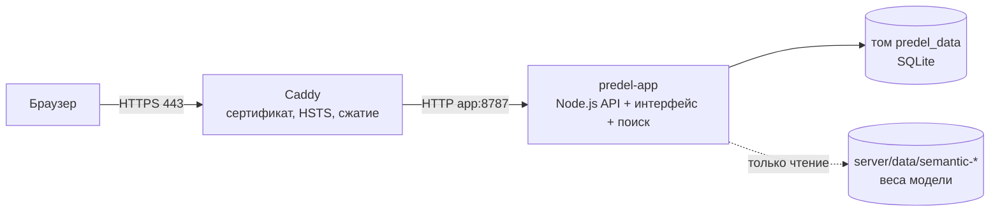

# Развёртывание на predel-ai.ru

Стенд: **https://predel-ai.ru**. Один сервер с Docker: контейнер приложения и Caddy. Caddy сам получает и продлевает сертификат Let's Encrypt.



## 1. DNS

Записи `A` (и `AAAA`, если есть IPv6) для `predel-ai.ru` и `www.predel-ai.ru` указывают на IP сервера. Порты 80 и 443 открыты: порт 80 нужен для выпуска сертификата и редиректа на HTTPS.

## 2. Код и модель

```bash
git clone <репозиторий> predel && cd predel
```

Веса смыслового поиска в Git не хранятся. Скопируйте с машины, где модель обучена, каталоги `server/data/semantic-model` и `server/data/semantic-runs/task-v2-search`, например через `rsync`. Без них сайт работает, но текстовый запрос в поиске сообщает, что поиск по смыслу недоступен; фильтры работают.

## 3. `.env` на сервере

```ini
DOMAIN=predel-ai.ru
WEB_ORIGIN=https://predel-ai.ru
COOKIE_SECURE=1
TRUST_PROXY=1
# Стенд для жюри: видны тестовые аккаунты и демо-вход ФСП ID.
# Для боевого режима — production (тестовые аккаунты и демо выключаются, нужна SMTP).
APP_ENV=stand
SETUP_LOCAL_ACCOUNTS=1

OPENROUTER_API_KEY=...
SMTP_HOST=...
SMTP_PORT=587
SMTP_TLS=starttls
SMTP_USER=...
SMTP_PASSWORD=...
SMTP_FROM="predel <no-reply@predel-ai.ru>"
```

- `COOKIE_SECURE=1` — cookie сессии только по HTTPS; запросы принимаются с origin `https://predel-ai.ru`.
- `TRUST_PROXY=1` — лимиты запросов считаются по адресу клиента, который передал Caddy, а не по адресу прокси.
- Если OpenRouter недоступен с сервера напрямую, задайте `DOCKER_HTTPS_PROXY`. Обычный `HTTPS_PROXY` из `.env` указывает на машину разработчика и в контейнере не используется.
- Настоящий ФСП ID (Keycloak): `FSP_ID_ISSUER`, `FSP_ID_CLIENT_ID`, `FSP_ID_CLIENT_SECRET` и `FSP_ID_REDIRECT_URI=https://predel-ai.ru/api/auth/fsp/callback` ([fsp_id.md](fsp_id.md)).

## 4. Запуск

```bash
docker compose --profile deploy up -d --build
docker compose logs -f app caddy
```

Проверка:

```bash
curl -s https://predel-ai.ru/api/health
```

Ответ — `{"status":"ok"}`. Swagger UI доступен на https://predel-ai.ru/api/docs.

Контейнер приложения слушает только `127.0.0.1:8787`, наружу открыт лишь Caddy. Данные лежат в томе `predel_data`. Резервная копия тома при остановленном приложении:

```bash
docker run --rm -v predel_predel_data:/data -v "$PWD":/backup alpine tar czf /backup/predel-data.tgz -C /data .
```

## Обновление

```bash
git pull
docker compose --profile deploy up -d --build
```

Схема SQLite мигрирует при старте. Тестовые аккаунты пересоздаются, только если их нет. Сброс тестовых кабинетов к исходному виду: `docker compose exec app node scripts/local-accounts.mjs --reset`.
