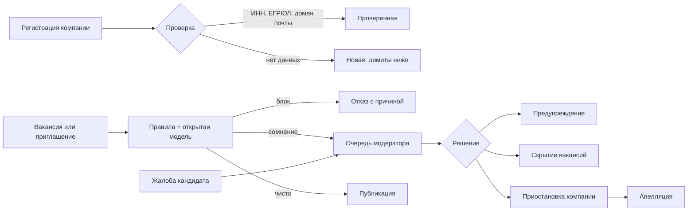

# Защита от фиктивных вакансий и недобросовестных работодателей

Обновлено 10 октября 2026 года. ТЗ (MVP, дополнительный объём) требует описать механизм и его место в архитектуре; полная модерация компаний в MVP не обязательна. Ниже — что уже работает в коде и что предлагается следующим этапом.

## Угрозы

| Угроза | Как выглядит | Чем вредит |
| --- | --- | --- |
| Плата с кандидата | «Оплатите обучение», «внесите депозит за оборудование» | Прямая потеря денег |
| Сбор личных данных | Просьба прислать паспорт, номер карты, код из SMS до найма | Кража личности и денег |
| Увод с платформы | «Пишите в телеграм», контакты в тексте вакансии | Обход защиты контактов и согласий |
| Фиктивная вакансия | Зарплата намного выше рынка, «лёгкий заработок», размытая вилка | Сбор откликов, реклама, мошенничество |
| Массовая рассылка | Сотни однотипных приглашений | Спам, сбор контактов |
| Сбор контактов | Приглашения ради e-mail и телефона | Утечка персональных данных |

## Что работает сейчас

| Механизм | Где | Проверка |
| --- | --- | --- |
| **Проверка текста вакансии и приглашения.** Требование оплаты, запрос паспорта, карты или кода из SMS блокируют публикацию, причина показывается работодателю. Контакты вне платформы, «лёгкий заработок», зарплата выше типичной для грейда и вилка шире чем втрое дают предупреждение только публикующему. Льготы за счёт компании («оплачиваем курсы») не блокируются. | [offer-risk.mjs](../server/offer-risk.mjs), вызов в `marketplace.publish/edit` и при создании приглашения | [offer-risk.test.mjs](../server/tests/offer-risk.test.mjs) |
| **Лимит приглашений:** не больше 30 новых приглашений в скользящие сутки | `platform.save` | там же |
| **Контакты только после согласия:** e-mail и телефон видны после принятого приглашения или отклика кандидата и при действующем согласии; демопрофили контакты не раскрывают | `platform.contacts` | [demo-isolation](../server/tests/demo-isolation.test.mjs), [application-privacy](../frontend/tests/application-privacy.mjs) |
| **Подтверждённый аккаунт:** работодатель регистрируется с кодом на почту; публиковать вакансию можно только с названием компании и e-mail для связи | `auth.mjs`, `marketplace.publish` | [auth.test](../server/tests/auth.test.mjs) |
| **Задания только после связи:** работодатель назначает задания тем, кто откликнулся или принял приглашение; не больше 60 в час | [refresh-tasks.mjs](../server/refresh-tasks.mjs) | [tasks-http.test](../server/tests/tasks-http.test.mjs) |
| **Изоляция тестовых аккаунтов:** открытые тестовые логины не видят реальных пользователей и не связываются с ними | `local-fixtures.mjs` | [local-fixture-isolation](../server/tests/local-fixture-isolation.test.mjs) |
| **ИИ без персональных данных:** в модели не передаются имя, контакты и идентификаторы | `assistant.mjs`, `task-review.mjs` | [assistant.test](../server/tests/assistant.test.mjs), [tasks-http.test](../server/tests/tasks-http.test.mjs) |

Правила проверки текста прозрачны и детерминированы: они отмечают шаблоны, а не намерения. Ложное срабатывание на льготах обработано исключением, остальные спорные случаи дают предупреждение, а не блок.

## Следующий этап

1. **Уровни доверия компании.** Новая компания: до 10 приглашений в сутки и до 3 открытых вакансий. Проверенная (ИНН и ОГРН сверены с ЕГРЮЛ через API ФНС, e-mail на домене сайта компании, подпись «Проверена») — обычные лимиты. Статус хранится в `marketplace_companies`, лимиты читаются из него.
2. **Жалобы.** Кнопка «Пожаловаться» на карточке вакансии, в приглашении и в задании: причина из списка («просят оплату», «просят данные карты», «вакансия не существует»…) и комментарий. Жалобы попадают на страницу `/moderation` рядом с достижениями и банком заданий. Три независимые жалобы скрывают вакансию до решения модератора.
3. **Модель для сомнительных случаев.** Открытая Qwen оценивает текст по тем же признакам и даёт обоснование. Сама модель не блокирует: сомнительная вакансия публикуется после проверки модератором.
4. **Санкции и апелляция.** Предупреждение → скрытие вакансий → приостановка компании. Каждое решение записывается в журнал с причиной; компания может оспорить его один раз.
5. **Сигналы поведения.** Доля принятых приглашений, жалобы на 100 приглашений, одинаковые тексты у разных компаний, частая смена реквизитов. Пороги подбираются по данным пилота.

Место в архитектуре: проверка текста — синхронно в API публикации; жалобы и решения — таблицы `employer_reports` и `employer_sanctions` в общей SQLite с аудитом, как у модерации достижений; уровни доверия — поле компании, которое читают лимиты `platform.save`, `marketplace.publish` и `refresh-tasks`.
